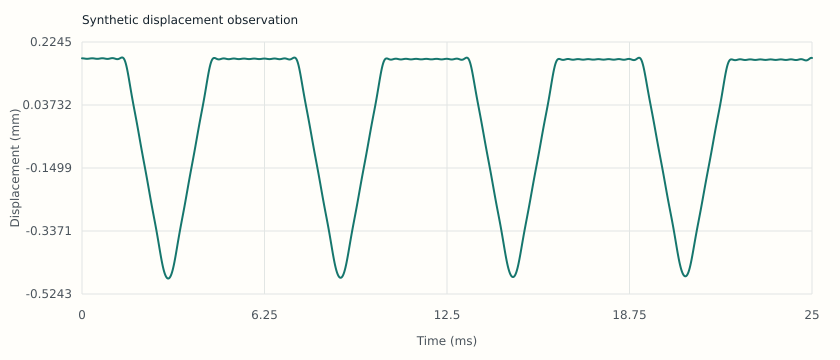

# Setar — physical-modeling engineering laboratory

A research-first, C++20 project for a physically modeled Iranian **setar** (سه‌تار).
The intended instrument generates sound from physical state and interactions, not
prerecorded notes. JUCE belongs at application/plugin boundaries; it is not the
physics engine.

**Current status: a working, playable physical-model prototype with synthetic
parameters.** The repository holds an engineering handbook, a verified numerical
bootstrap, and `setar::instrument`, a C++20 engine that turns physical gestures
(fingernail strokes, finger presses, slides, releases) into sound through
string, contact, bridge and body mechanics. It renders scores to audio today.
It is **not** a finished or validated setar synthesizer: every string gauge,
body dimension, contact law, tuning and fret map is a declared synthetic or
historical-theory placeholder, nothing has been measured on a real instrument,
no setar player has reviewed it, and no listening test has been run. It makes no
claim of parity with any commercial instrument.

## Where the project stands

### Implemented and covered by passing tests

| Area | What exists | Evidence |
| --- | --- | --- |
| Strings | Four persistent strings, two transverse polarizations each, exact-modal update with three-term frequency-dependent loss (synthetic preset: 71–112 modes per polarization, 732 degrees of freedom with the body) | `solver.*` against closed-form oscillators; open-string pitch within a stated truncation budget of the ideal stiff string |
| Contacts | Fingernail stroke with force/travel release, finger pads, tied-fret obstacles, fret stick spring, lateral finger damping, solved simultaneously by a bounded discrete-gradient Newton step | Discrete energy ledger closes to about 1e-12 of peak stored energy; release displacement within 2 % of the quasi-static oracle and converging from 48 to 192 kHz; fretted pitch −0.48 cents |
| Bridge and body | Stiff bridge springs to a synthetic modal body: orthotropic plate plus Helmholtz cavity plus one lateral mode, 48 modes from 155 Hz to 7 kHz | Independent finite-difference plate oracle, closed-form cavity coupling, mobility reciprocity and passivity; sympathetic transfer only through the shared body; exact zero in the uncoupled limit |
| Presets | Synthetic plain strings tuned C4–G3–C3–C4 (courses {0}, {1}, {2,3}), a reconstructed 17-interval Pythagorean fret map and a 24-EDO grid, 25 frets each | `preset.*` |
| Performance layer | Text score grammar (pluck, strum, tremolo, press, slide, release, touch, damp, silence) and an allocation-free MIDI mapper | `score.*` |
| Realtime properties | `process()` is noexcept and allocation-free; block-size invariance and replay are bitwise | `realtime.*`, `contact.gesture_replay` |
| Offline player | `setar_play` renders a score to WAV with diagnostics and a summary; `tools/analyze_render.py` writes graphs and an HTML page | `integration.setar_play` renders all four demo scores with zero faults |
| Cross-platform CI | Headless build and every CTest on Ubuntu 24.04 (GCC), Windows 2022 (MSVC, warnings as errors) and macOS 15, plus a Linux address/undefined-behaviour sanitizer job, and score rendering on all three | [Run 41177416020](https://github.com/cheshmakzanoon-ops/setar/actions/runs/41177416020) on commit `1db2dcf`: all four jobs passed |

[Listen to and inspect the demonstration renders](docs/assets/prototype/README.md).
They are synthetic renders of an unvalidated model, not recordings.

### Known limits

- **Nothing is measured or validated.** All parameters are synthetic; fidelity to a
  real setar is unknown.
- **Physics simplifications:** linear string (no tension rise or pitch glide when
  pressed or plucked hard), frictionless point contacts apart from the stick
  spring, prescribed nail path, rectangular plate instead of the real soundboard,
  rigid bowl, radiation folded into modal damping, uncalibrated observation.
- **Realtime budget is not met in the worst case.** On this development container
  a dense four-string gesture pattern needs about 0.8 of one core at 48 kHz, and
  its 99th-percentile 256-sample block takes longer than the block lasts. The demo
  scores render 2.5–3.9 times faster than real time with the ledger on. These are
  single-machine measurements, not qualifications.
- **The JUCE plugin adapter is written but not compiled.** It configures against
  JUCE 8.0.10 and passes a syntax check; it has not been built, hosted or validated.
- **The gesture grammar and fret maps have no practitioner review.** Stroke names,
  dynamics and ornaments are engineering placeholders.

### Appropriate next steps

Work proceeds by evidence gate, not by date. In order:

1. **Keep the baseline green.** The Linux, Windows, macOS and sanitizer jobs
   passed for the prototype merge; every later change must keep them passing,
   and a configured job is not evidence for an untested platform (REQ-LAB-002).
2. **Meet the realtime budget.** Profile the worst-case block, reduce the
   per-sample contact cost (block-sparse compliance, SIMD modal updates,
   register-dependent mode caps) and record deadline percentiles (REQ-RTS-001,
   ENG-P13-T02). Then build the JUCE adapter where external code may be compiled,
   run a plugin validator and one host, and record the results (ENG-P14-T01).
3. **Choose and document a reference instrument.** Select a real setar with the
   owner's permission and record its construction and setup (ENG-P00-T01,
   ENG-P01-T02). This is the gate that turns the prototype into a model of an
   instrument instead of a model of a placeholder.
4. **Measure before fitting.** Strings (mass, tension, stiffness, per-partial
   decay), fret positions and action, bridge mobility in both directions, and
   nail/finger contact behaviour, each with calibration and uncertainty
   ([acquisition instructions](docs/measurement/13-acquisition-campaign-execution.md)).
   Check identifiability before optimizing any parameter (ENG-P12-T01).
5. **Replace synthetic parts with measured ones**, keeping the synthetic preset as a
   regression fixture: measured string parameters, a body reduced from measured
   FRFs or an FEM of the real soundboard and bowl (ENG-P08-T01..T03).
6. **Add the missing physics in order of expected audibility**, each with an
   independent oracle test: tension modulation, nail and finger friction, bridge
   contact geometry, a radiation model (ENG-P04-T02, ENG-P05-T02, ENG-P10-T02).
   Compare the engine with an independent high-resolution reference solver
   (REQ-RTS-002).
7. **Obtain practitioner review** of tunings, fret maps, strokes and ornaments under
   the consent process (REQ-PRF-002), then run preregistered held-out acoustic
   comparisons and blind listening tests (P17).
8. **Choose a license and clear asset rights** before any distribution (P18).

Read the [prototype chapter](docs/engineering/11-playable-prototype.md) for the
full capability register and the [roadmap](docs/ROADMAP.md) for every gate.

### Try it

```sh
cmake --preset headless-release
cmake --build --preset headless-release
build/headless-release/setar_play --score data/scores/03-phrase.score --output-dir artifacts/play/phrase --ledger
python3 tools/analyze_render.py --input artifacts/play/phrase --output artifacts/play/phrase-report
```

Open `artifacts/play/phrase-report/index.html` to hear the render and see its
spectrogram, energy ledger and pitch estimates. Write your own score with the
[score format](docs/performance/07-score-format.md).

## Start here

1. [Read the orientation and capability boundaries](docs/START_HERE.md).
2. [Follow the phase-by-phase engineering roadmap](docs/ROADMAP.md).
3. [Use the evidence and acceptance rules](docs/governance/quality-contract.md).
4. [Open the implementation-level engineering specification](docs/engineering/implementation-specification.md):
   [41 requirements](roadmap/requirements.json) and
   [44 detailed work orders](roadmap/engineering-tasks.json) with dependencies,
   source/test locations, implementation instructions, and evidence handoffs.
   The [phase-task crosswalk](roadmap/phase-task-crosswalk.json) connects all
   **119 original scientific phase tasks** to those granular work orders.
5. [Read the relevant technical volume](docs/INDEX.md), not the whole handbook at once.
6. [Select a bounded implementation or review prompt](prompts/README.md).
7. Build the reference scaffold, reproduce its tests, and attach evidence to changes.

The [open decision-gate ledger](docs/governance/engineering-decision-gates.md)
identifies measurements, method choices, permissions, and host qualifications
that cannot be resolved by writing more prose. **Planned tests and proposed
C++ interfaces are not necessarily implemented features.** The new
[executed-prototype coverage registry](roadmap/executable-test-coverage.json)
maps **27 of 79 planned acceptance names to *partial* executable checks**;
52 are not yet mapped, and the full 41 engineering requirements are not
claimed as completely verified. The
[solver comparison and decision dossier](docs/architecture/07-experimental-solver-evidence-and-choice.md),
[real specimen acquisition instructions](docs/measurement/13-acquisition-campaign-execution.md),
[C++ contract and executable test handoff](docs/engineering/10-prototype-contracts-and-test-expansion.md)
and [real VST3/product qualification gates](docs/plugin/07-product-qualification-evidence-gates.md)
identify the exact current evidence and outstanding work.

There are **no project deadlines or calendar estimates** in this roadmap. Phases
advance when their evidence gates are met. Activities such as data acquisition,
numerical verification, and interface design can proceed independently where the
dependency graph permits it.

## Project boundaries

| Commitment | Meaning |
| --- | --- |
| Physics-led synthesis | Derive motion and acoustic output from documented models and state. |
| C++ first | A dependency-light C++20 numerical core, with explicit units and ownership. |
| Honest evidence | Distinguish hypotheses, synthetic fixtures, published values, measured data, and validated conclusions. |
| Cross-platform | Linux, Windows, and macOS build/test workflows; separate manual host and audio-hardware evidence. |
| Reproducibility | Pinned inputs, deterministic fixtures, tolerance policies, artifacts, and traceable decisions. |
| Cultural specificity | Model Iranian setar construction and performance, with practitioner review; do not substitute an Indian sitar or generic guitar. |
| Measurable fidelity | Define a reference specimen, gestures, listening conditions, error budgets, and held-out tests. |

“Pianoteq-level” is a user aspiration for responsiveness and physical-modeling
quality. Pianoteq is a third-party product and trademark, not an implementation
reference, an affiliation, or a certified quality level. This project does not
copy proprietary source, presets, measurements, or designs.

## Build the numerical bootstrap and the prototype

The intended baseline is CMake, a C++20 compiler, and Python 3 for report and
documentation tooling. See [engineering setup](docs/engineering/README.md) for
the exact current build commands and toolchain requirements.

```sh
cmake --preset headless-debug
cmake --build --preset headless-debug
ctest --preset headless-debug
build/headless-debug/setar_play --score data/scores/01-open-strings.score --output-dir artifacts/play/open-strings
python3 tools/audit_docs.py
python3 tools/audit_implementation.py
python3 tools/audit_executable_coverage.py
python3 tools/validate_measurement_campaign.py data/measurement-campaign-template.json
python3 tools/validate_product_qualification.py data/product-qualification-template.json
```

The headless path must not download JUCE or require an audio device. The optional
JUCE path requires an explicitly supplied checkout and a reviewed license choice.
Do not mistake a passing bootstrap test, or a pleasant prototype render, for
measured instrument validation. `setar_play` writes the render of a synthetic
score together with its diagnostics; see the
[offline player chapter](docs/engineering/12-offline-player-and-analysis.md).

## Repository map

| Path | Responsibility |
| --- | --- |
| `docs/phases/` | Ordered work packages, dependencies, evidence gates, and handoffs. |
| `roadmap/requirements.json`, `roadmap/engineering-tasks.json` | Machine-checked requirements, 44 implementation work orders, named planned tests and exact procedures. |
| `docs/engineering/implementation-specification.md`, `docs/architecture/` | Implementation contracts, proposed C++ ownership/interfaces, solver selection and signal-flow diagrams. |
| `docs/research/`, `docs/measurement/` | Primary-source audit, specimen acquisition, measurement protocols, and uncertainty. |
| `docs/mathematics/`, `docs/numerics/` | Governing equations, discretization, energy, stability, and convergence. |
| `docs/strings/`, `docs/contacts/`, `docs/performance/` | String behavior, nail/fret contacts, gestures, and tuning. |
| `docs/geometry/`, `docs/body/`, `docs/acoustics/` | Geometry, elastic structure, bridge coupling, cavity, radiation, and observation. |
| `docs/realtime/`, `docs/plugin/`, `docs/ux/` | Bounded processing, host contracts, and musician/engineering interfaces. |
| `docs/validation/` | Verification, acoustic validation, perceptual evaluation, and release evidence. |
| `docs/governance/`, `docs/decisions/` | Scope, acceptance policy, risks, decision records, and stewardship. |
| `include/`, `src/` | Public numerical interfaces and implementation; `include/setar/instrument` and `src/instrument` hold the playable prototype engine. |
| `apps/`, `tests/`, `tools/` | Executable experiments, independent tests, reports, and audits. |
| `data/`, `experiments/` | Data contracts, synthetic demonstration scores (`data/scores`) and reproducible experiment definitions, not unlicensed recordings. |
| `plugin/` | Optional JUCE adapter for the prototype (`SETAR_ENABLE_JUCE_INSTRUMENT`), not part of the headless matrix. |
| `prompts/` | Scoped instructions for human or AI-assisted implementation, review, and investigation. |
| `.github/` | Cross-platform CI and contribution templates. |

## Evidence and visuals

Numerical reports must display their input manifest, model identity, units, source
commit, and limitations. Graphs of synthetic data must say so. Screenshots are
captures of actual rendered interfaces/reports; design mockups are labeled as
mockups. CI artifacts and review evidence are described in the engineering and
validation volumes. No promotional image is evidence of acoustic fidelity.

[View the reproducible diagnostic graphs and visual-capture instructions](docs/assets/README.md).
These visualize a **synthetic string reference**, not a validated setar model.



The [finite-mode energy graph](docs/assets/energy.svg),
[stiffness-dispersion graph](docs/assets/dispersion.svg), and
[proposed musician-interface wireframe](docs/ux/assets/musician-wireframe.svg)
are also included. The wireframe is a design proposal, **not** an implemented
plugin editor or a screenshot from a running VST.

CI additionally generates three actual synthetic numerical solver error
graphs and a 60-row explicit-versus-implicit CSV in the `solver/report`
artifact. The explicit finite-difference scheme rejects configurations
outside its calculated CFL domain. These are real executable experiments,
**not measured setar audio, live UI captures or finished VST3 host tests**.

## Contributing

Read [CONTRIBUTING.md](CONTRIBUTING.md) and [AGENTS.md](AGENTS.md). Contributions
must include tests, relevant uncertainty/assumption updates, and appropriate
cross-platform evidence. Research data and third-party dependencies carry their
own permission and provenance obligations. No open-source redistribution license
is selected by this initial setup; see [rights and dependencies](docs/governance/rights-and-dependencies.md).
