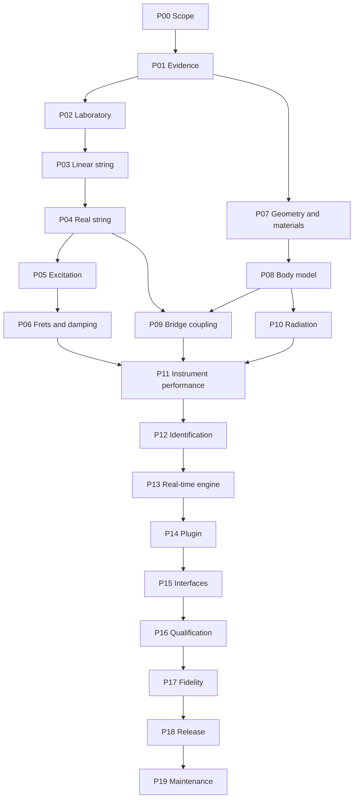

# Master engineering roadmap

## Outcome and operating principle

Build a playable, responsive, primarily C++ physical model of the Iranian setar
whose claims are supported by reproducible numerical verification and independent
instrument measurements. The aspiration is the care, expressiveness, stability,
and refinement associated with leading physical-modeling instruments; no brand
name substitutes for an acceptance criterion.

This roadmap is ordered by **dependencies and evidence**, not dates. A phase is a
work package, not a sprint length. There are no deadlines or delivery estimates.
Some investigations run in parallel, but a downstream model cannot inherit
credibility from an unverified upstream assumption.

## The phase register

Each detailed phase contains reading, prerequisites, tasks, outputs, tests, prompts,
and handoff conditions. All scientific completion states begin unproven. The
repository bootstrap only implements a limited subset of the laboratory/tooling
work; inspect source and CI for current capabilities.

The machine-readable [phase register](../roadmap/phase-register.json) records
dependencies, documentation paths, and current evidence-status boundaries. The
documentation auditor checks that its dependency graph has no cycles or missing
phase documents. The register does **not** claim a phase passed its scientific
gate merely because its instructions have been written.

For **implementation-level execution**, use the
[41 traceable requirements](../roadmap/requirements.json), the
[44 dependency-ordered engineering work orders](../roadmap/engineering-tasks.json),
and the [implementation specification](engineering/implementation-specification.md).
Each work order contains exact reading prerequisites, proposed source and test
paths, procedural steps, falsifiable checks, evidence outputs and a status that
currently means *specified, not implemented*. The 79 planned test identifiers
are future acceptance targets; they do not describe CTests that already exist.
The machine-backed work orders use the distinct **`ENG-Pxx-Tyy`** namespace:
existing individual phase chapters already use `Pxx-Tyy` for their broader
phase-level tasks. The two series intentionally do not share identifiers or
pretend to be identical subtasks; each engineering work order links to its
own phase and required reading.
Their consistency is checked by `python3 tools/audit_implementation.py`,
including task dependency cycles, coverage, reading links and status vocabulary.
The [open decision-gate ledger](governance/engineering-decision-gates.md)
states which physics, calibration, realtime, host and permission choices remain
unresolved until experiments/review, no matter how detailed the instructions.

| Phase | Work package | Principal evidence gate |
| --- | --- | --- |
| [P00](phases/P00-charter.md) | Scope, fidelity claims, and research governance | A bounded target and honest claim taxonomy. |
| [P01](phases/P01-evidence.md) | Primary-source and data audit | Admissible, traceable inputs; unknowns quarantined. |
| [P02](phases/P02-laboratory.md) | Reproducible C++ reference laboratory | Independent tests and artifacts run on all three OS families. |
| [P03](phases/P03-linear-string.md) | Linear string reference and discretization | Frequency, boundary, energy, and convergence evidence. |
| [P04](phases/P04-real-string.md) | Stiffness, loss, polarizations, and nonlinear extension | Added physics verified separately from fitted tone. |
| [P05](phases/P05-excitation.md) | Nail excitation and release | Contact work, release behavior, and gesture limits established. |
| [P06](phases/P06-frets-damping.md) | Movable frets, fingers, damping, and retuning | State transitions conserve/account for work and dissipative loss. |
| [P07](phases/P07-geometry-materials.md) | Specimen geometry and material characterization | Reusable geometry and admissible material fields with uncertainty. |
| [P08](phases/P08-body-model.md) | Structural finite-element and modal body model | Mesh convergence and mode/FRF agreement for declared boundaries. |
| [P09](phases/P09-bridge-coupling.md) | Multiport bridge and string–body coupling | Passive interaction and cross-string response verified. |
| [P10](phases/P10-acoustic-radiation.md) | Cavity, exterior radiation, and observation | Coupled acoustic response and microphone mapping validated. |
| [P11](phases/P11-instrument-performance.md) | Four-string instrument and performance semantics | Physically persistent state and practitioner-approved gesture behavior. |
| [P12](phases/P12-identification.md) | Calibration, identifiability, and uncertainty | Held-out prediction improves without invalid parameter compensation. |
| [P13](phases/P13-realtime.md) | Reduced real-time C++ engine | Numerical and perceptual differences bounded; callbacks safe. |
| [P14](phases/P14-plugin.md) | JUCE/VST3 and host integration | Stable host lifecycle, state, events, and portable plugin tests. |
| [P15](phases/P15-interfaces.md) | Musician UI, laboratory UI, graphs, and visual QA | Useful observable controls and reproducible visual evidence. |
| [P16](phases/P16-qualification.md) | Cross-platform and host qualification | Current source passes the declared automated/manual coverage matrix. |
| [P17](phases/P17-fidelity.md) | Acoustic and perceptual fidelity evaluation | Defined claims survive independent held-out evaluation. |
| [P18](phases/P18-release.md) | Packaging, rights, reproducibility, and release | Auditable artifact provenance and explicit distribution permissions. |
| [P19](phases/P19-maintenance.md) | Long-term scientific maintenance | Regressions, evidence, migrations, and new physics remain traceable. |

## Dependency graph

The diagram shows evidence dependencies for a release claim, not an instruction
to postpone all UI or measurement planning. Design measurement protocols during
P01. Start native host smoke tests with a synthetic reference in P02. Draft
interface wireframes before P14. Do not declare their final gates passed until
the integrated behavior is actually tested. Calibration experiment design belongs
early, even though formal integrated identification is P12.

## The thread that connects every phase

Every work package must preserve the same chain:

**physical question → model assumption → numerical representation → executable
experiment → expected result → observed result → uncertainty → claim**.

For example, “the fourth string rings sympathetically” is not a sufficient task.
Specify which reference specimen, tuning, initial conditions, bridge directions,
and observation point are involved. Define the coupling model and its power
variables. Create a fixture where one string is driven and another is initially
silent. Verify reciprocity/passivity where assumed. Compare predicted and measured
cross-response in a held-out condition. State where the result applies.

This level of precision prevents a plausible sound from masking an incorrect
mechanism. It also prevents an abstractly correct solver from being presented as
an authentic instrument without measurement or musician input.

## Work-package template

Use [the task template](../templates/task.md). A useful task names one uncertainty
or behavior, its source and prerequisites, the exact files or interface it affects,
the implementation/experimental procedure, independent checks, acceptance
artifacts, known limits, and the next action. Work-package identifiers use
`Pxx-Tyy` within their phase; numerical experiments use `EXP-...`; requirements
use `REQ-...`; decisions use `ADR-...`. Do not reuse an identifier for a different
question after results change.

Do not paste the whole roadmap into every ticket or AI prompt. Include the
necessary contracts, a small file scope, and links to the exact chapters. Ask for
one falsifiable result. A task that says “implement realistic setar” is too broad
to review and too easy to satisfy with an unrelated synthesizer.

## Architecture checkpoints

### Before a solver exists

Agree on coordinates, positive forces, velocities, displacement units, string
indexing, boundary conditions, and the observation definition. Resolve whether a
quantity is displacement, particle velocity, force, pressure, volume velocity,
or a dimensionless calibrated audio signal. A bridge mobility cannot be connected
to a displacement sample merely because both are stored as `double`.

### Before subsystems are coupled

Write the power balance at every port and test each component independently.
Decide how forces and velocities are time-staggered. Test coupling in a lossless,
unforced fixture and a known dissipative fixture. Do not add a one-sample feedback
delay casually; it changes phase and may break passivity. If an explicit scheme
requires a delay, derive and validate that scheme as a separate approximation.

### Before optimization

Freeze a reference version and a corpus of initial states/gestures. Specify
comparison metrics and numerical tolerance. Measure what optimization changes:
floating-point order, interpolation, modal truncation, solver iteration limits,
state layout, or multirate boundaries. Demonstrate both correctness and runtime
effects. A speedup that only works on quiet, short notes is not an engine budget.

### Before plugin packaging

Document every host-visible parameter, unit, range, identifier, smoothing rule,
and state migration. Decide which controls change physical configuration and
which only affect observation. Prepare a fixed event-capacity policy that cannot
leave notes stuck after overflow. Test zero-size blocks, variable block sizes,
sample-rate changes, suspend/resume, reset, offline rendering, and project reload.

### Before fidelity claims

Hold back specimens, players, gestures, or combinations that were not used for
calibration. Match recording conditions and levels. Separate defects of the
physical model from those of event mapping, microphone rendering, and the room.
Report effect sizes and uncertainty, not only an attractive plot or an average
classification score. A null result in a small listening study is not proof of
indistinguishability.

## What can proceed without the missing raw setar data

The mathematical and software work does not require inventing measured values.
Engineers can build synthetic reference fixtures for ideal strings, stiff strings,
damped modes, contact interactions, plate patches, acoustic cavities, and coupled
oscillators. Those fixtures verify the implementation and are essential even after
real data arrive.

What cannot proceed honestly is a claim that the synthetic parameters reproduce
the particular laboratory instrument from a paper. The missing geometry, modal
residues, material fields, contact parameters, and measurement conditions must be
obtained or explicitly replaced by an independently characterized specimen.
The [research volume](research/README.md) defines how to request and audit those
inputs. Do not leave acquisition as an invisible dependency behind a “sounds good”
milestone.

## Done means evidence, not document length

A phase is complete only when its required artifacts are attached to a reviewed
change and the gate decision explains both what passed and what remains outside
scope. A rejected experiment is a valid result if its data and reasoning are
reproducible. A work package may be partially implemented while its scientific
gate remains open. Record that fact rather than lowering the criterion quietly.

The repository's content audit reports its actual prose count. It does not
certify scientific accuracy or satisfy a phase gate by itself. Use the
[quality contract](governance/quality-contract.md),
[risk register](governance/risk-register.md), and domain review prompts to make
those judgments.
