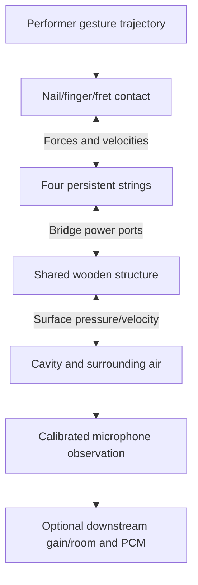
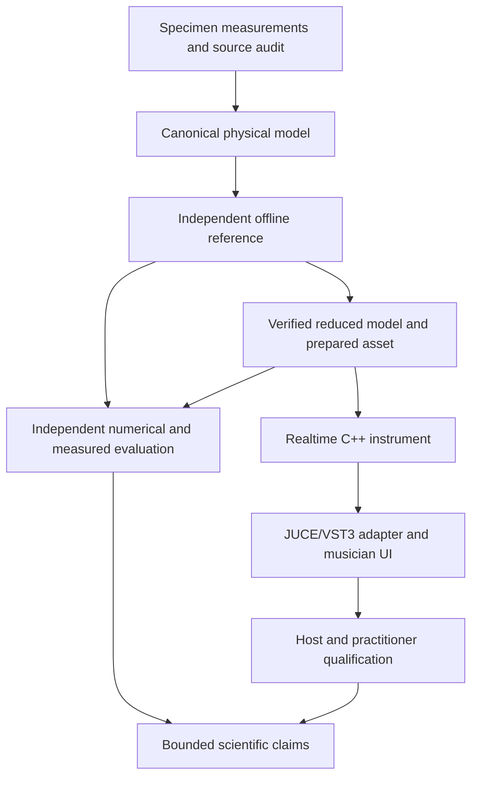
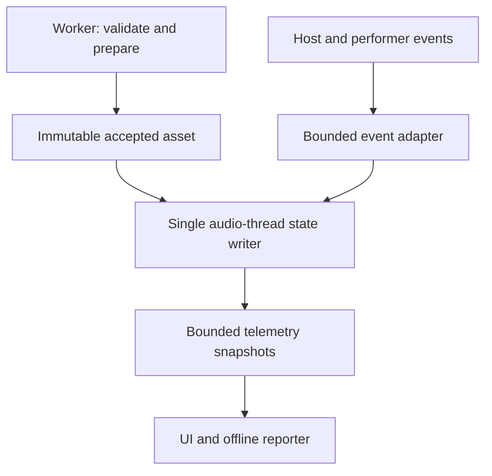

# Physical state, observation and evidence flow

These diagrams describe **proposed** component relationships, not currently
compiled and tested modules. They are kept small so a contributor can see
which state/energy boundaries require a verification fixture.

## Physical signal/energy model

The contact element may contain a driven external work source (the performer's
motion) as well as passive losses. The body/cavity feedback may matter for
physical energy, depending on the adopted model. The downstream microphone
observation and playback gain do not become a new mechanical force just
because the same plugin renders them. The string-to-body path is bidirectional;
an outgoing rendered audio sample is not a substitute for a returned bridge
velocity. Proposed owner and type contracts are in
[C++ module contracts](04-cpp20-module-contracts.md) and
[coupling scheme selection](05-discrete-solver-selection.md).

## Evidence to runtime and product claims

Only an accepted source can enter a calibrated asset; a purely synthetic input
can still enter an **explicitly synthetic** reference fixture. Numeric
verification and measured validation are separate. A review may reject the
proposed reduced model without invalidating the whole reference laboratory.
Similarly, a successful JUCE build without real host tests cannot satisfy the
product-qualification branch. No diagram represents a completed phase gate.

## Data ownership under concurrency

Old asset destruction, expensive parsing, graphics and disk work happen outside
the realtime callback. A copied snapshot is safe only after its lifetime and
publication protocol are verified. An atomic pointer by itself does not solve
reclamation. Refer to [engine realtime requirements](../realtime/README.md),
[handoff work order ENG-P13-T02](../../roadmap/engineering-tasks.json), and
[the performance budget method](../engineering/performance-budget.md).
