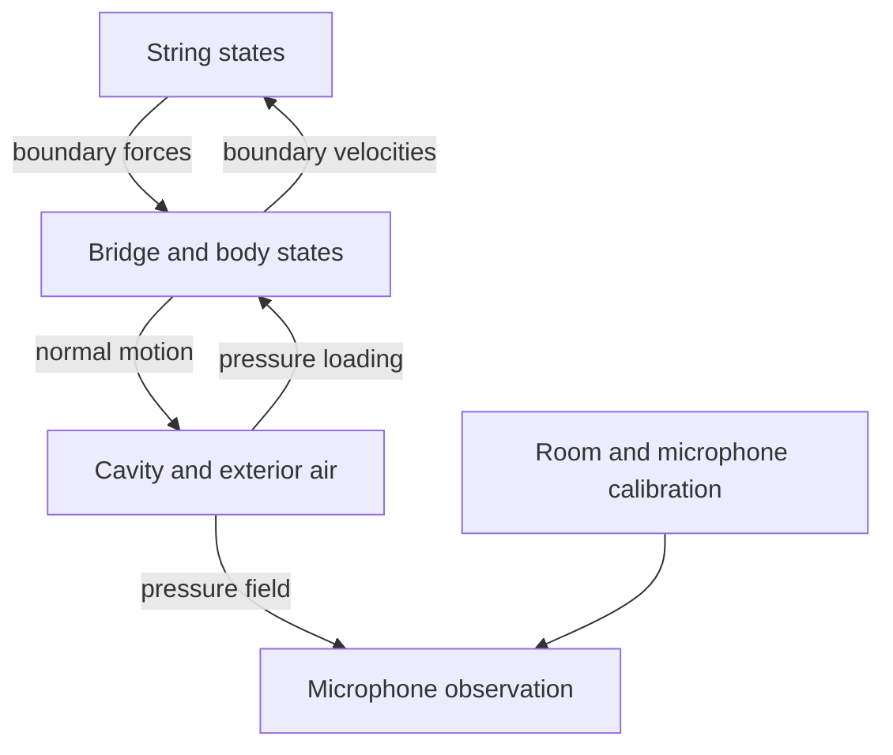

# Structural body and bridge engineering

Status: this volume specifies proposed, unimplemented specimen-body workflows. It does not contain measured CAD, calibrated wood tensors, measured mobility, or a validated setar body asset. Synthetic examples verify mathematics only.

Read after the [geometry volume](../geometry/README.md):

1. [Orthotropic material admissibility and source audit](01-orthotropic-material-audit.md).
2. [Joints, finish, supports, and preload](02-joints-finish-and-preload.md).
3. [Bridge contact and multiport string feedback](03-bridge-contact-and-multiport-coupling.md).
4. [Structural FEM and mesh convergence](04-structural-fem-and-mesh-convergence.md).
5. [Eigenmodes, normalization, and tracking](05-eigenmodes-normalization-and-tracking.md).
6. [Measured FRFs and modal identification](06-measured-frfs-and-modal-identification.md).
7. [Damping and causal materials](07-damping-and-causal-materials.md).
8. [Passive reduction and residual flexibility](08-passive-reduction-and-residual-flexibility.md).
9. [Structural identifiability and experiment design](09-parameter-identifiability-and-experiment-design.md).

The central architecture distinguishes a feedback load from an observation:

The diagram is a dependency statement, not an implemented software graph. Every bidirectional edge needs a shared work convention and synchronized numerical update. The observation path must not replace the physical feedback path.

P07 establishes geometry and materials; P08 establishes structural response; P09 establishes bridge interaction; P10 adds acoustics; P13 reduces the accepted model. Use the [master roadmap](../ROADMAP.md) for gates and the [acoustic work orders](../../prompts/acoustics/01-implementation-work-orders.md) for bounded tasks.

The strongest immediate blockers are absent specimen measurements, uncertain interior geometry and joints, and incomplete material characterization. The published setar material table is audited rather than treated as a ready tensor. A successful generic string build cannot close these evidence gaps.
