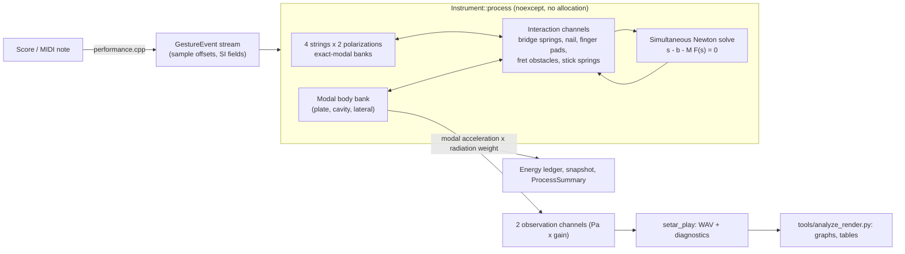

# Playable setar prototype: architecture, capability register and evidence gates

**Status: implemented prototype with synthetic parameters.** The repository now
contains a playable four-string physical model, `setar::instrument`, that renders
sound from physical state and contact interactions. Every string gauge, body
dimension, material constant, contact law, tuning and fret map it uses is a
declared synthetic placeholder or an explicitly labeled historical/educational
interval set. It is **not** a measured digital twin of any setar, it has not been
acoustically or perceptually validated, and it makes no claim of parity with any
commercial instrument. Passing CTests demonstrate the numerical properties they
name, at the scope they name, and nothing more.

This chapter is the entry point for the prototype. It describes what exists,
where each responsibility lives, how to run it, which evidence actually exists,
and which gates remain open. The governing numerical derivation is in
[the modal-contact solver chapter](../numerics/15-modal-contact-solver.md).

## Prerequisites and sources

Read [orientation](../START_HERE.md), the [quality contract](../governance/quality-contract.md)
and the relevant phases: [P05 excitation](../phases/P05-excitation.md),
[P06 frets and damping](../phases/P06-frets-damping.md),
[P09 bridge coupling](../phases/P09-bridge-coupling.md),
[P11 four-string instrument](../phases/P11-instrument-performance.md) and
[P13 real-time engine](../phases/P13-realtime.md). The discrete-gradient contact
step follows the energy-consistent collision formulations of Chatziioannou and
van Walstijn, *Energy conserving schemes for the simulation of musical instrument
contact dynamics*, Journal of Sound and Vibration 339 (2015) 262–279,
[doi:10.1016/j.jsv.2014.11.017](https://doi.org/10.1016/j.jsv.2014.11.017), and the
collision paper already in the source ledger, Bilbao, Torin and Chatziioannou,
*Numerical Modeling of Collisions in Musical Instruments*,
[doi:10.3813/AAA.918813](https://doi.org/10.3813/AAA.918813). Chapter 15 states
which equations of those methods the prototype adopts and where it departs from
them. The exact-modal oscillator update is the sampled free response of a
linear damped oscillator; its derivation and energy identity are restated in
[`numerics.hpp`](../../include/setar/instrument/numerics.hpp) and chapter 15.
These sources justify the method; they supply no setar parameter.

## What the prototype computes

| Layer | Physical content | Discretization | Source |
| --- | --- | --- | --- |
| Strings | Four persistent strings, each a uniform stiff string simply supported at the nut (x = 0) and the tail anchor, with a bridge contact between them; two transverse polarizations (vertical, horizontal) per string; three-term frequency-dependent loss | Sine-mode bank per polarization, modes below min(`max_mode_frequency_hz`, 0.45 fs); exact-modal three-level update | [`config.hpp`](../../include/setar/instrument/config.hpp), [`numerics.cpp`](../../src/instrument/numerics.cpp) |
| Bridge | Linear spring (and optional damper) per string and polarization between the string at its bridge position and the body bridge contact | Interaction channel solved simultaneously with every other channel; no sample delay | [`instrument.cpp`](../../src/instrument/instrument.cpp) |
| Body | Modal body seen from the bridge: synthetic orthotropic simply supported soundboard plate, optional Helmholtz cavity coupling and one lateral bridge mode | Same exact-modal bank; reduced `BodyConfig` with per-contact participation and radiation weights | [`body_model.hpp`](../../include/setar/instrument/body_model.hpp), [synthetic body chapter](../body/10-synthetic-prototype-body.md) |
| Contacts | Fingernail (one-sided power law along the stroke direction, force/travel release), finger pads (one-sided from above, flesh damping), tied-fret obstacles (one-sided from below), fret stick spring (horizontal), lateral finger damper | Discrete-gradient force per channel; small dense Newton with bounded iterations | [`numerics.hpp`](../../include/setar/instrument/numerics.hpp), [chapter 15](../numerics/15-modal-contact-solver.md) |
| Observation | Two pressure channels from body modal acceleration through synthetic monopole/dipole weights; fixed gain | One-way: never feeds back into mechanics; never normalized or clipped | [`instrument.hpp`](../../include/setar/instrument/instrument.hpp) |
| Gestures | Sample-accurate `NailStroke`, `FingerPress`, `FingerMove`, `FingerRelease`, `Silence` on a physical string index | Applied before the sample at their offset; out-of-order events rejected and counted | [`gesture.hpp`](../../include/setar/instrument/gesture.hpp) |
| Performance layer | Text score and MIDI-like note mapping to physical gestures via the fret map; courses as stroke groupings | Offline parsing/scheduling; realtime-safe note mapper | [`performance.hpp`](../../include/setar/instrument/performance.hpp), [score format](../performance/07-score-format.md) |
| Presets | Synthetic plain-string gauges, tunings, fret maps and contact laws assembled into an `InstrumentConfig` | Tension from target pitch with the stiff-string inverse; ideal-string fret positions | [`setar_preset.hpp`](../../include/setar/instrument/setar_preset.hpp), [preset chapter](../strings/08-prototype-string-and-fret-presets.md) |

A note never creates a string, voice or sample. The performance layer chooses a
physical string and finger position; the realized pitch is whatever the coupled
physical model produces, including contact compliance, bridge loading and finger
offset behind the fret.

## Signal and state flow



Each sample: (1) every modal bank predicts its free update; (2) the engine
assembles the channels whose contact is active or predicted to become active,
including the eight bridge channels; (3) one Newton solve finds all channel
forces at the same time level; (4) forces are scattered into the modal banks; (5)
the observation is formed from body modal acceleration; (6) the optional ledger
books stored energy, actuator work, dissipation and channel switching.

## Module and ownership map

| Module | Header | Implementation | Tests | CMake target |
| --- | --- | --- | --- | --- |
| Numerical blocks: modal bank, contact laws, Newton | [`numerics.hpp`](../../include/setar/instrument/numerics.hpp) | [`numerics.cpp`](../../src/instrument/numerics.cpp) | [`numerics_tests.cpp`](../../tests/instrument/numerics_tests.cpp) (`solver.*`) | `setar_instrument_numerics` |
| Coupled engine and config validation | [`instrument.hpp`](../../include/setar/instrument/instrument.hpp), [`config.hpp`](../../include/setar/instrument/config.hpp), [`gesture.hpp`](../../include/setar/instrument/gesture.hpp) | [`instrument.cpp`](../../src/instrument/instrument.cpp), [`config.cpp`](../../src/instrument/config.cpp) | [`engine_tests.cpp`](../../tests/instrument/engine_tests.cpp) (`engine.*`, `contact.*`, `coupling.*`, `performance.*`, `acoustics.*`, `controls.*`) | `setar_instrument_engine` |
| Synthetic body | [`body_model.hpp`](../../include/setar/instrument/body_model.hpp) | [`body_model.cpp`](../../src/instrument/body_model.cpp) | [`body_tests.cpp`](../../tests/instrument/body_tests.cpp) (`materials.*`, `body.*`) | `setar_instrument_body` |
| Presets, tunings, fret maps | [`setar_preset.hpp`](../../include/setar/instrument/setar_preset.hpp) | [`setar_preset.cpp`](../../src/instrument/setar_preset.cpp) | [`preset_tests.cpp`](../../tests/instrument/preset_tests.cpp) (`preset.*`) | `setar_instrument_preset` |
| Performance layer | [`performance.hpp`](../../include/setar/instrument/performance.hpp) | [`performance.cpp`](../../src/instrument/performance.cpp) | [`performance_tests.cpp`](../../tests/instrument/performance_tests.cpp) (`score.*`) | `setar_instrument_performance` |
| Realtime contract | (engine headers) | (engine) | [`realtime_tests.cpp`](../../tests/instrument/realtime_tests.cpp) (`realtime.*`, `contact.gesture_replay`) | `setar_instrument_realtime_tests` |
| Offline player and analysis | — | [`setar_play.cpp`](../../apps/setar_play.cpp), [`analyze_render.py`](../../tools/analyze_render.py) | [`test_setar_play.py`](../../tools/test_setar_play.py) (`integration.setar_play`) | `setar_play` |
| Benchmark | — | [`setar_benchmark.cpp`](../../apps/setar_benchmark.cpp) | — | `setar_benchmark` |
| Optional JUCE adapter | — | [`plugin/`](../../plugin/CMakeLists.txt) | Not in the headless matrix | `SETAR_ENABLE_JUCE_INSTRUMENT=ON` only |

The core libraries are plain C++20 and do not include any JUCE header. Each test
runner links only the modules it exercises so that module boundaries stay explicit.
Detailed chapters: [offline player and analysis](12-offline-player-and-analysis.md),
[JUCE adapter](../plugin/08-prototype-juce-adapter.md) and
[realtime evidence](../realtime/05-prototype-realtime-evidence.md).

## Inputs, outputs and units

Inputs are an `InstrumentConfig` (SI: metres, newtons, kg/m, N·m², 1/s, Hz,
N/m^α, N·s/m) and a `ProcessSpec` (sample rate, block, event, channel and
iteration capacities, Newton tolerance in metres, fixed output gain per pascal,
optional ledger). Both are validated in `prepare()`, which throws
`std::invalid_argument` naming the failing field and leaves any previous prepared
state intact. Gestures carry SI fields; their sign conventions are defined in
[`config.hpp`](../../include/setar/instrument/config.hpp) and
[`gesture.hpp`](../../include/setar/instrument/gesture.hpp): vertical is positive
away from the soundboard, horizontal is positive toward physical string 3, and x
runs from the nut.

Outputs are two float channels of observed pressure multiplied by the fixed gain,
a `ProcessSummary` with fault code and counters, an `InstrumentSnapshot` (nail
phase and force, finger states, bridge forces, energies) and, when enabled, an
`EnergyLedger` whose residual is
`(stored − initial) − external work + dissipation − switching`.

## Procedure: build, test and play

```sh
cmake --preset headless-debug
cmake --build --preset headless-debug
ctest --preset headless-debug -L instrument --output-on-failure
build/headless-debug/setar_play --score data/scores/01-open-strings.score --output-dir artifacts/play/open-strings
```

The player accepts only a new or empty output directory and writes the
render together with diagnostics; see the
[player chapter](12-offline-player-and-analysis.md) for every option, output
file and the analysis report command. The score files under
[`data/scores`](../../data/scores) are synthetic demonstration phrases; their
headers carry a status line that reports must reproduce. For realtime factor
measurements use `setar_benchmark` with an optimized build and record the machine,
compiler, flags and sample rate next to every number.

## Tests and acceptance evidence

The prototype registers its tests through the CMake function
`setar_instrument_tests`. Seventeen of them carry the names of planned acceptance
identifiers and are recorded in the
[executable coverage registry](../../roadmap/executable-test-coverage.json) as
**executable_partial** with the subset they check and the gap they leave. With
the earlier ten mappings, 27 of the 79 planned identifiers now have a partial
executable check; 52 have none, and no requirement is declared fully passed.
`tools/audit_executable_coverage.py` rejects a coverage mapping whose runner still
dispatches the name to a `not_implemented` stub, an unregistered name, or a
runner that differs from the CMake registration.

Independent comparators used by the prototype tests include: the sampled analytic
damped oscillator (modal bank), the exact discrete-gradient identity
`F·s = −ΔV − R s²/(2k)` (contact laws), bisection for scalar Newton problems,
the transcendental eigen-equation of a string with a point spring, the
closed-form orthotropic plate frequency and an independent eigen-solve for the
plate–cavity coupling, the ideal stiff-string fundamental for open and fretted
pitch, and the quasi-static point stiffness `T L / (x (L − x))` for the release
state of a slow stroke.

## Capability register

The columns are deliberately separate. "Tested locally" names the CTests that
exercise a capability; whether they passed on a given commit is recorded in the
commit/PR record and CI logs, not asserted by this table. "Exercised in CI" means
the test is part of the configured headless matrix; a configured job is not a
completed run on every platform.

| Capability | Implemented | Tested locally (CTests) | Exercised in CI | Acoustically validated | Deferred |
| --- | --- | --- | --- | --- | --- |
| Exact-modal string and body banks, three-term loss | Yes | `solver.modal_*`, `engine.lossy_energy_ledger` | Configured | No | Measured loss separation from bridge leakage |
| Two transverse polarizations | Yes, independent banks coupled through contacts and bridge | `engine.lossless_energy_ledger` | Configured | No | Nonlinear tension, polarization coupling terms |
| Simultaneous bridge/body coupling | Yes | `coupling.uncoupled_limit`, `coupling.cross_string_transfer`, `engine.*_energy_ledger` | Configured | No | Measured multiport mobility, independent coupled solver |
| Synthetic plate/cavity/lateral body | Yes | `body.*`, `materials.*` | Configured | No | FEM of a real pear-shaped soundboard and bowl, measured FRFs |
| Nail stroke with release | Yes, prescribed trajectory, frictionless | `contact.nail_passivity`, `contact.release_convergence` | Configured | No | Friction, nail compliance/mass, measured contact law, strike-speed envelope |
| Finger pads, frets, stick spring, afterlength | Yes | `engine.fretted_pitch`, `contact.fret_crossing_work`, `contact.release_afterlength`, `controls.sweep_continuity` | Configured | No | Measured fret/finger laws, pressing tension rise, lateral bends |
| Sympathetic strings | Yes, through shared body only | `coupling.cross_string_transfer` | Configured | No | Detuning study, measured transfer |
| Persistent four-string state | Yes | `performance.persistent_state`, `performance.restrike_memory` | Configured | No | Practitioner-reviewed gesture matrix |
| Energy ledger | Yes, optional | `engine.lossless_energy_ledger`, `engine.lossy_energy_ledger` | Configured | Not applicable | Radiation work separated from modal damping |
| Bounded, allocation-free `process()` | Designed and hook-tested | `realtime.allocation_hook`, `realtime.max_work`, `realtime.capacity_overflow`, `realtime.block_partition`, `contact.gesture_replay` | Configured | Not applicable | Measured deadline distributions, lock/syscall audit, asset publication |
| Score and MIDI mapping | Yes, engineering placeholder grammar | `score.*` | Configured | No | Practitioner review (REQ-PRF-002) |
| Synthetic presets | Yes | `preset.*` | Configured | No | Reference specimen strings, frets and tuning practice |
| Offline player and analysis report | Yes | `integration.setar_play` | Configured, plus a render step | No | Calibrated level, listening study |
| JUCE adapter | Source behind an option | None in the headless matrix | No | No | Build in CI, validator, host matrix |

## Failure modes and containment

- `NotPrepared`, `InvalidBlock`: the block output is zeroed and the fault is
  reported; no partial state change.
- `InvalidEvent`, `EventOverflow`: the event is ignored and counted; events are
  never silently reordered.
- `ChannelCapacityExceeded`: more simultaneous channels than the prepared
  capacity; reported, never silently truncated into a different physical system
  without a counter.
- `NewtonNotConverged`: the iteration cap was reached; the last iterate is used
  and counted, so a reviewer can reject a render that relied on it.
- `NonFiniteState`: a containment reset zeroes the mechanical state and is booked
  as a reset, not as physics.

A render produced while any fault counter is nonzero is not evidence of the
physical property under test. The player stops on faults unless explicitly told
to continue, and then records the counts.

## Limitations

- Every parameter is synthetic. The soundboard is a rectangular simply supported
  plate, not the specimen's soundboard or bowl; radiation damping is absorbed into
  modal damping; the observation is uncalibrated.
- Contacts are frictionless point interactions; the nail follows a prescribed path
  and releases at a force threshold or travel limit. Pressing does not raise string
  tension; there is no lateral bending of the string by the finger.
- Truncated sine bases smooth point contacts; the error of sharp contacts with
  respect to modal truncation has not been bounded for every gesture.
- The score grammar, stroke names, dynamics and fret maps are engineering
  placeholders, not documented practice of any performer.
- Realtime safety is a source and hook-test property of `process()`; no host,
  hardware or deadline qualification exists.

## Next evidence gates

1. Replace synthetic strings, frets and tuning with a reference specimen record
   (ENG-P01-T02, ENG-P04-T01) and keep the synthetic preset as a fixture.
2. Compare the coupled engine against an independent high-resolution reference
   for nail release and fret contact (ENG-P05-T02, ENG-P13-T01).
3. Replace the analytic plate with an FEM of a measured body and a measured bridge
   mobility, then rerun `body.mobility_*` against data (ENG-P08-T01..T03).
4. Run the headless matrix on all three platforms and record the run identifiers;
   build the JUCE adapter in a conditional job and run a plugin validator
   (ENG-P14-T01, ENG-P16-T01).
5. Obtain practitioner review of the gesture grammar before any performance claim
   (ENG-P11-T02).
