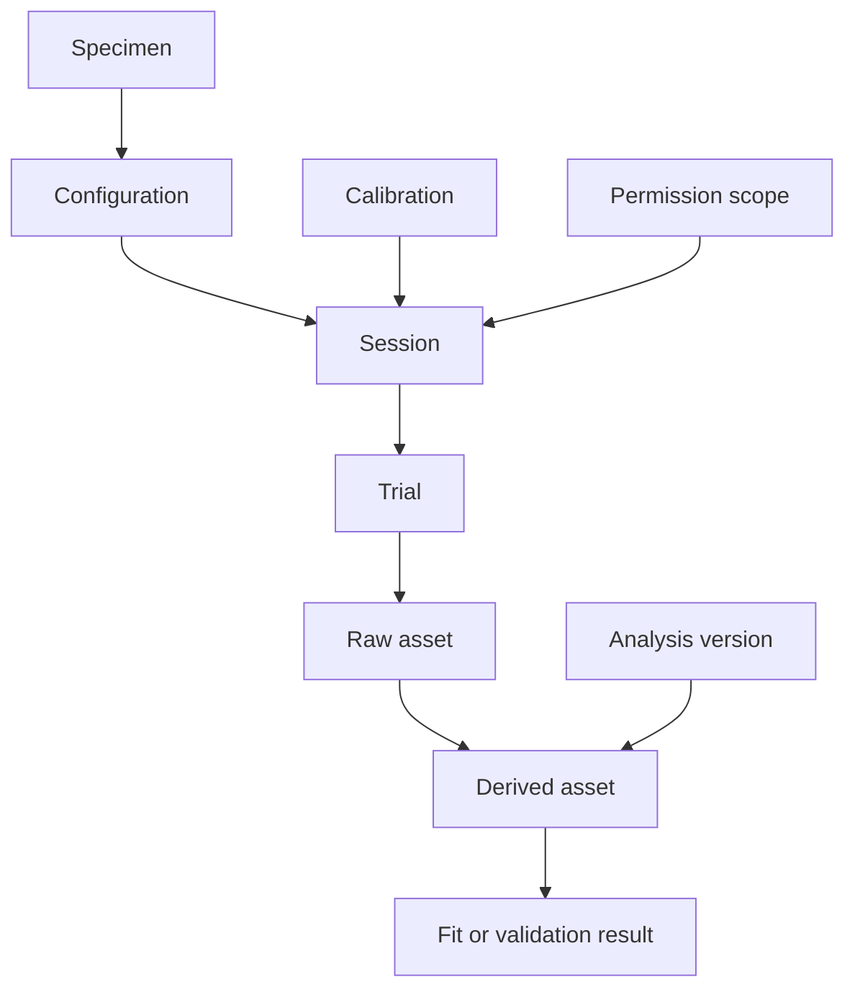

# Measurement data contracts and provenance

## The contract is part of the experiment

A file becomes scientific evidence only when its meaning can be reconstructed.
Sample values without units, time base, channel identity, calibration, specimen
state, and permission are not a complete measurement. The data contract must be
designed before acquisition so the operator can capture the required metadata
while it is still observable.

This chapter defines a proposed logical schema. It is not an assertion that a
schema validator or dataset already exists. Implementations may use JSON, YAML,
HDF5, tabular files, or another suitable representation, but they must preserve
the semantics described here. A schema migration is a versioned transformation,
not a silent rename of fields.

## Entity graph



These links carry constraints. A trial must reference the configuration that
actually existed. A derived asset inherits relevant restrictions from its inputs.
A fit must identify which data were used for calibration and which were reserved
for validation. A session identifier cannot substitute for a calibration record,
because calibration can change within a session and one calibration may apply to
several sessions within its validated domain.

## Stable identifiers

Use stable opaque identifiers for specimens, configurations, sessions, trials,
participants, calibrations, assets, transformations, fits, and permissions. Human-
readable labels can change without changing identity. Do not encode personal
names, email addresses, or unnecessary location information in filenames or
identifiers. Maintain any required private identity linkage separately.

Identifiers should be unique across merged datasets. A local `take01` is not
enough when multiple operators produce files. Use a project namespace or a
collision-resistant scheme and validate referential integrity. Avoid relying on
filesystem modification times as the authoritative acquisition order; copying
files can change them.

Separate capture time, ingest time, processing time, and metadata-edit time. Store
time zone and clock source where relevant. A timestamp may have uncertainty or be
unknown. Do not fabricate a precise UTC time from a handwritten note that only
specifies the session order.

## Quantity records

A physical quantity needs value, unit, uncertainty, evidence kind, and provenance.
For vectors or tensors, add coordinate frame and component convention. A useful
logical record is:

```yaml
quantity_id: Q-PENDING
name: speaking_length
value: null
unit: m
evidence_kind: proposed
uncertainty:
  standard_uncertainty: null
  distribution: null
  coverage_factor: null
  correlation_group: null
provenance:
  method_id: null
  raw_asset_ids: []
  calibration_ids: []
validity:
  configuration_id: null
  temperature_range_k: null
  amplitude_domain: null
status: missing
```

The nulls are deliberate. This is a template, not a measured record. A production
measurement schema should require fields appropriate to its evidence kind. For
example, `measured` requires acquisition provenance, while `published` requires a
source identifier and extraction location. `synthetic` requires a generator and
purpose. Unknown values must not be encoded as zero, because zero can be a valid
physical value.

Store uncertainty semantics explicitly. A standard deviation of repeated trials,
an instrument specification bound, and a confidence interval are not equivalent.
Do not put all three in a field named `error`. Preserve correlations through a
shared calibration identifier or covariance object rather than assuming every
field is independent.

## Channel records

Every raw channel has a quantity, sensor, unit at each stage, calibration chain,
direction, location, sample rate, clock, and saturation policy. Preserve raw
digital counts or voltages when practical so later calibration corrections can
be applied reproducibly. A pre-calibrated signal may also be stored, but it must
name the transformation that created it.

```json
{
  "schema_version": "proposed-1",
  "channel_id": "CHANNEL-PENDING",
  "status": "template_only",
  "quantity": "force",
  "raw_unit": "V",
  "physical_unit": "N",
  "sensor_id": null,
  "calibration_chain_ids": [],
  "sample_rate_hz": null,
  "clock_id": null,
  "location_m": null,
  "direction_unit_vector": null,
  "coordinate_frame_id": null,
  "positive_sign": "Force entering the defined body port",
  "raw_asset_id": null
}
```

For an LDV channel, store the beam direction and the relation between measured
line-of-sight velocity and the desired port velocity. For a microphone, store
orientation and calibration information. For video, store frame timestamps,
camera model, exposure information when available, and synchronization mapping.
A channel label such as `mic1` is a convenience, not a definition.

## Raw-asset manifest

The manifest records asset identifier, original filename, format, byte count,
cryptographic checksum, acquisition source, ingest result, rights status, and
storage location. Checksums detect accidental modification; they do not prove
scientific validity or ownership. Verify them after transfer and before analysis.
Never invent a checksum for a file that has not been acquired.

Keep raw assets immutable. Corrections belong in metadata versions or derived
assets, not destructive edits of the only original. If a legal or privacy
obligation requires deletion, follow the approved process and preserve an
appropriate tombstone record without retaining the prohibited content. Do not
promise permanent retention in consent language if the project cannot deliver it.

Store restricted and distributable assets separately enough that packaging cannot
accidentally include participant video or private permissions. Access control
must be enforced by storage and tooling, not merely by a README warning. Public
repository paths should contain schemas, synthetic fixtures, and explicitly
approved data only.

## Trial and event records

A trial records intended task, actual observed state, operator notes, quality
flags, and links to all synchronized channels. Intended articulation and observed
articulation can differ. Preserve both. A trial marked unsuccessful for one
analysis may still be useful for a contact-failure study, but only with the
appropriate permission and classification.

Event annotations include start/end intervals, label vocabulary version,
annotator or detector identity, confidence meaning, and evidence references. Do
not collapse an uncertain release interval into an exact timestamp merely
because a downstream function expects one number. The downstream interface
should accept uncertainty or state how it reduces the interval.

Quality flags should be structured: clipping, double impact, optical dropout,
clock uncertainty, tuning drift, handling noise, occlusion, or rights restriction.
Allow explanatory text, but do not depend on free text alone for exclusion
logic. The analysis must record which flags caused exclusion and which were
accepted with qualification.

## Derived transforms

Every transformation names its input assets, code version, parameters, numerical
environment, output assets, and validity checks. A calibration transform should
state gain, offset, frequency correction, polarity, and time alignment. A spectrum
transform should state Fourier convention, window, normalization, averaging,
frequency grid, and rejected intervals. A geometry transform should state
registration, filtering, interpolation, and provenance masks.

Use content hashes for important configuration objects where practical. A Git
commit alone does not capture uncommitted local edits, external calibration files,
or command-line parameters. Record a dirty-worktree indicator and exact relevant
configuration. Do not export credentials, private paths, or unnecessary system
environment variables into public provenance.

Derived data should retain units. A complex FRF can be stored as real and imaginary
arrays with a common frequency vector and explicit unit. Magnitude and phase
exports need phase units and wrapping convention. Avoid mixing degrees and
radians in fields that are merely named `phase`.

## Fits and validation records

A fit record includes model version, parameter definitions, objective function,
weights, constraints, initializations, random seeds, calibration data, exclusions,
optimizer outcomes, uncertainty analysis, and residual diagnostics. Store
unsuccessful attempts when they are relevant to reproducibility and not excessive
in size. Selecting only one favorable run hides multimodality and boundary issues.

A validation record must state whether the data were independent of parameter
fitting, model-order selection, manual listening adjustment, and threshold
selection. These are separate leakage routes. A flag named `test=true` is not
credible without the partition history. If a failed test motivates a revision,
preserve that result and mark the reused data as development evidence for the
next model.

## Rights propagation

Attach permission records to assets and specify whether they permit analysis,
internal sharing, public release, commercial use, derivative parameter release,
and use of identifying imagery or names. These categories should reflect actual
agreements reviewed through the appropriate process, not a generic assumption.
The schema does not provide legal advice or substitute for counsel when needed.

A derivative's permitted use is constrained by all relevant inputs. Combining an
open calibration file with a restricted performance does not make the output
open. A fitted coefficient may or may not be covered by the original agreement;
resolve that scope explicitly rather than assuming transformation removes rights
or privacy concerns. Public release tooling should require an affirmative
distribution decision.

## Validation rules

Implement structural validation for required fields and types, then semantic
validation for units, ranges, references, and state consistency. Examples include
a direction vector with unit norm, positive sample rate, matching channel lengths,
monotonic timestamps, known coordinate frames, no duplicate identifiers, and
calibration validity covering the claimed domain. A syntactically valid JSON file
can still be scientifically unusable.

Add cross-record tests: a trial cannot reference a configuration created after
an unrecorded state change; a derived asset cannot omit a restricted parent; a
fit cannot list the same raw event in calibration and independent test through
different derived files. Some checks require explicit human review, but tooling
should surface the conflict rather than silently accept it.

## Handoff

Deliver a schema specification, small synthetic examples, invalid fixtures with
expected failure messages, and an ingest report for every real dataset. Include
an operator checklist that matches the schema so mandatory fields are captured
at acquisition rather than reconstructed from memory. The gate passes when a
new analyst can interpret, validate, and reproduce the data without private
explanations. The next action is to implement validators before scaling acquisition.

