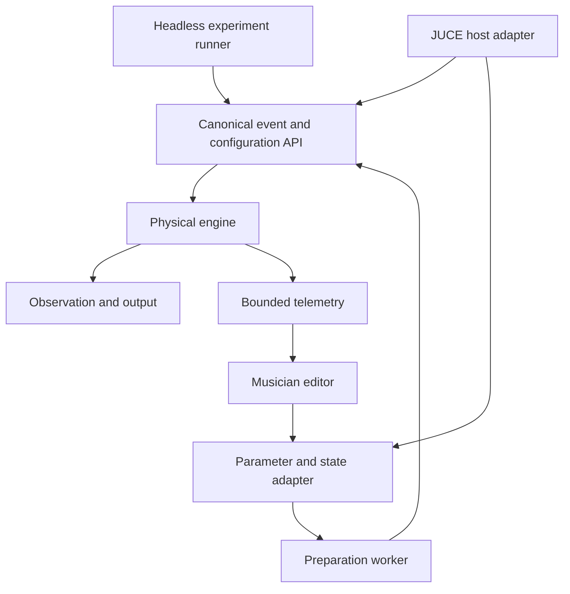

# Plugin architecture: a thin host boundary around a physical core

The proposed product has a C++20 physical core, an offline reference application,
and optional JUCE-based application/plugin adapters. JUCE supplies useful host,
parameter, MIDI, and interface facilities; it does not supply the setar physics
or validate it. The initial reference scaffold is synthetic and must retain that
identity even if a diagnostic editor can play it.

## Architectural dependency rule

The numerical core depends on standard C++ and explicitly reviewed numerical
utilities, not JUCE. Public core types express units, ownership, capacities,
events, and error status. The adapter translates framework buffers and events
into those types. Tests can instantiate the core without a GUI, audio device,
plugin SDK, or network access.

The diagram describes intended ownership, not an assertion that all components
already exist. Keep the standalone and plugin paths on the same event and
configuration API. A wrapper-specific oscillator or undocumented gain correction
would make headless evidence irrelevant to the delivered instrument.

## Core layers

Separate physical configuration from numerical realization. Physical data include
geometry, material descriptions, tuning, contact parameters, and observation
geometry. Numerical data include discretization, modal truncation, internal
rates, workspaces, and solver limits. A prepared model records both so a report
can identify the approximation actually used.

Separate physical state from control state. String displacement and body modal
velocity are not ordinary automatable parameters. A control target describes
what a user or host requests; a physically meaningful transition determines how
that request affects state. This distinction prevents a slider from directly
overwriting an evolving coordinate or coefficient without energy accounting.

Separate observation from synthesis. A receiver position, artistic output gain,
and metering view should not secretly change string motion. If a pickup or load
feeds back mechanically, model that explicitly rather than hiding it in the
output layer. The boundary helps diagnose a plausible bridge response with an
incorrect microphone spectrum.

## Adapter responsibilities

The host adapter owns format identifiers, bus negotiation, sample-rate and block
preparation, transport interpretation, event translation, latency and tail
reporting, processing precision, and error containment at the host boundary.
It also owns the declared mapping from host parameters to core controls. Rich
errors belong outside processing; the callback uses bounded status and telemetry.

JUCE's [AudioProcessor reference](https://docs.juce.com/master/classjuce_1_1AudioProcessor.html)
is the primary API source for its processing/lifecycle methods. Pin a JUCE
revision and inspect its contracts before implementation. Framework documentation
for the latest branch is not proof that an older supplied checkout behaves
identically. Wrapper tests should identify the exact framework revision.

The editor owns presentation and interaction, not engine lifetime. Closing the
editor must not stop synthesis, change parameters, or destroy a resource still
used by audio. Multiple editor instances or repeated open/close cycles must
remain safe according to framework and host behavior. Avoid making the engine
depend on a UI timer for parameter propagation or state installation.

## Application and format scope

Start with a headless laboratory and a diagnostic standalone path where useful.
An eventual VST3 instrument is a cross-platform target where the chosen framework
supports the intended platform. Audio Unit is a macOS-specific target with its
own identifiers, validation, and host behavior. Do not imply that one wrapper's
success establishes another's compatibility.

Choose product identifiers once with deliberate ownership. Manufacturer codes,
plugin codes, bundle identifiers, names, and parameter IDs enter saved sessions
and scanner caches. Changing them can cause a host to regard a build as a
different product. Do not invent an organization identity or publishing account
for convenience; use approved project values and keep development/test variants
distinct where needed.

The optional build must use an explicitly supplied dependency checkout and a
reviewed license choice. It must not download a moving JUCE branch during an
ordinary headless build. Dependency provisioning, packaging, and publication
are distinct actions with separate authorization. A build configuration that
lists VST3 or AU is not evidence that either binary was produced successfully.

## Interface contracts

Document the buffer contract: channels, layout, precision, sample count,
ownership, alignment requirements if any, and whether input audio is used.
An instrument may have no audio input, but the adapter still needs to handle
host-provided buffer conventions correctly. Clear unused output channels and
never write beyond the actual channel or sample extent.

Document the event contract: supported message families, time convention,
identity, ordering, capacity, overflow, and rejected-input policy. The framework
may provide MIDI bytes, richer format events, or parameter changes through
different routes. Normalize only after preserving their meaning. A generic
MIDI translation can lose note identity or sample-accurate automation; explicitly
state any limitation rather than claiming transparent support.

Document the configuration contract: accepted schema, preparation cost,
validation, installation boundary, state mapping, failure behavior, and lifetime.
The core should not know file paths or UI widgets. The adapter resolves assets
and produces validated immutable data before the audio owner uses them.

## Test seams

Provide a framework-free fixture runner for numerical tests and an adapter
harness for lifecycle and translation tests. The first isolates physics; the
second proves the wrapper drives it correctly. Feed the same canonical events
through both and compare output within the numeric policy. Add tests where host
blocks vary and where events coincide with boundaries.

Inject a fake preparation worker or deterministic executor in tests so state
installation order can be controlled. Inject a bounded telemetry sink that
counts overflow. Do not add production locks merely to simplify tests; model the
actual ownership protocol. Test seams should expose behavior without changing
its semantics.

Keep format-specific checks separate. A VST3 validator, Audio Unit validation,
pluginval, and actual DAWs test different aspects. No single checker certifies
all hosts, all audio devices, or acoustic fidelity. Record the executable and
plugin hashes for every tool run.

## Failure patterns

A plugin that plays only with its editor open has misplaced ownership or polling.
A plugin that differs from the headless render may have lost events, changed
gain, changed block semantics, or selected different coefficients. A plugin that
fails only during scanning may be allocating resources or opening devices too
early. A plugin that restores controls but not sound may have serialized visible
parameters without the model asset or mapping revision.

Investigate these with the layered harness rather than patching each host
individually first. Host-specific workarounds sometimes become necessary, but
must be narrow, documented, and tested against the general contract. An opaque
host-name branch can conceal an underlying lifecycle defect.

## Acceptance and next action

Acceptance requires dependency direction, public core contracts, adapter mapping,
identifier registry, test seams, and observed build/test records for claimed
formats. The next action is to integrate the verified reference core into one
thin adapter and compare canonical renders. Label it a diagnostic instrument
until physical, host, and usability gates support a broader product claim.
