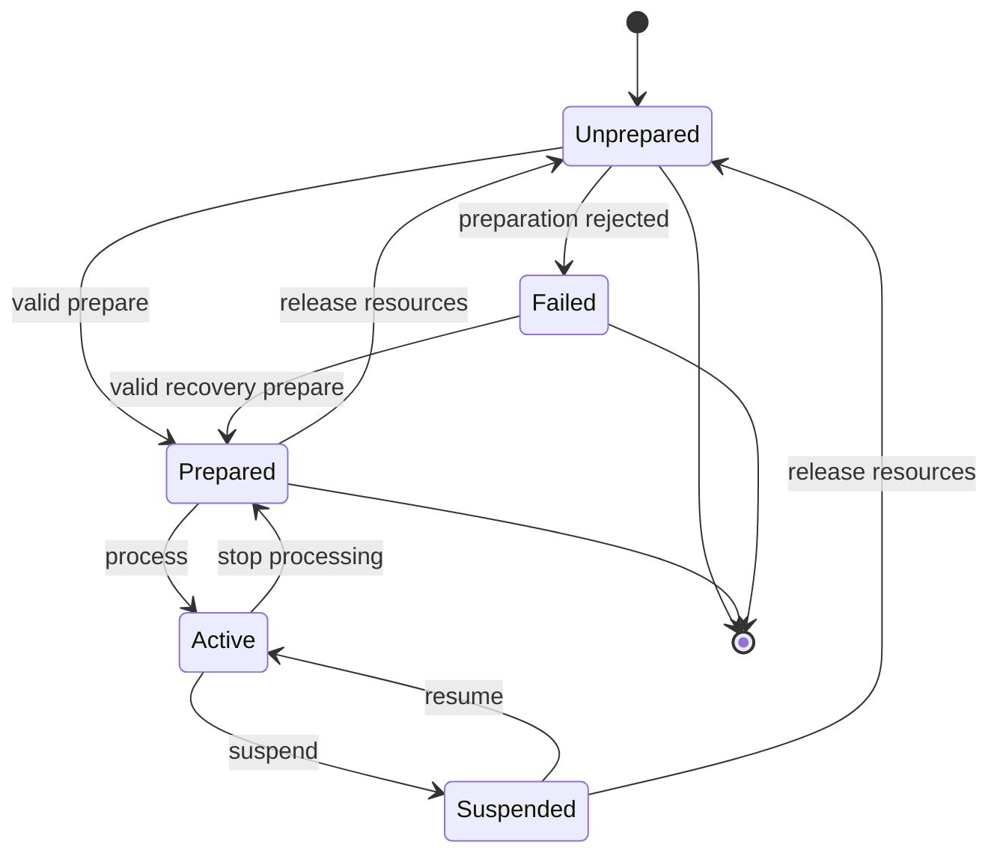

# Host lifecycle, buses, sample rates, latency, and tails

Hosts do not always call a plugin in the sequence seen in a friendly standalone
demo. They scan, instantiate without an editor, prepare repeatedly, change block
sizes, suspend, restore state, render offline, and destroy objects after partial
initialization. This chapter specifies lifecycle behavior and its test matrix.
It is a product contract distinct from acoustic validation.

## Explicit lifecycle state machine

Define unprepared, prepared, active, suspended, failed, and destroyed states, with
allowed transitions and ownership. Construction should establish safe defaults
without opening audio devices or performing expensive specimen fitting. A plugin
scanner may construct many instances merely to inspect metadata. Preparation
validates the requested sample rate, bus layout, precision, capacities, and
prepared physical configuration.

This diagram is conceptual; actual wrapper call contracts govern implementation.
Test repeated preparation and resource release for idempotent cleanup. Do not
assume destruction is preceded by every optional lifecycle call. Failed
preparation must leave an object safe to inspect and destroy.

## Preparation and sample-rate changes

Sample rate affects discretization, filters, smoothing, timestamps, and reported
latency. Validate it before division or allocation. Recompute prepared numerical
data outside processing and establish a state-transition policy. Simply retaining
old delay indices or modal coefficients after a rate change can retune the model
or violate stability.

Decide whether a rate change resets physical state, projects it, or crossfades
prepared engines. A reset can be acceptable when the host has stopped processing,
but should be documented and tested. State projection needs a physical and
numerical argument. A crossfade needs bounded doubled work and lifetime handling.
The method must preserve parameter meaning even when internal realization changes.

Test every supported rate and transitions between rates, including unusual but
admissible values. Avoid claiming that only common rates exist unless the plugin
explicitly rejects others. Test a rejected rate without leaving stale buffers
or dividing by an invalid value. A sample-rate-dependent mode count needs a
declared bandwidth/truncation policy and convergence evidence.

## Block-size variability

Treat the host's expected block size as preparation information, not permission
to index every callback to that size. Process the actual sample count. Test zero,
one, small, irregular, and larger-than-expected blocks under the documented
framework contract. If chunking is used, preserve event offsets and coefficient
trajectories across chunks.

Never clear, copy, or render beyond the actual buffer extent. Do not allocate
when a larger block appears. A supported maximum may require preallocated storage
or an algorithm that processes bounded chunks with fixed scratch. Unsupported
conditions need a defined safe response and diagnostic. Test silence and active
tails under each block pattern.

Compare one canonical event stream across block partitions. A difference caused
by smoothing reset, per-block randomization, or block-aligned note onset is a
semantic defect, not floating-point noise. Permit only the declared numeric
variation and explain any algorithm that intentionally uses block-dependent
processing.

## Bus layouts and channel ownership

Specify supported layouts: for example, a no-input instrument with mono or stereo
output, plus any explicitly supported auxiliary output. This is a design choice,
not a default guarantee. Use the framework's bus helpers and actual channel
counts rather than assuming the buffer has two channels. Clear channels that
are outputs but not written by the core.

Reject unsupported layouts through the correct negotiation path. Do not accept
a layout and then write a different channel count. Test channel routing with
distinct diagnostic signals so swapped channels or incorrect offsets are visible.
Test disabled buses, host layout changes, and instances that never open an editor.

Define mono behavior physically or artistically. A mono receiver may be a
distinct observation; a fold-down may be a mix of stereo channels. They need
not be identical. State which is used and test polarity/cancellation. Output
format changes must not silently change excitation or internal string count.

## Precision and transport

Advertise double-precision processing only if the wrapper actually implements it
correctly. A host double buffer may be converted to an internal precision under
a declared policy, but that conversion and its error require tests. Do not
reinterpret float memory as double or assume host precision remains unchanged
between preparations.

Transport information may be absent or discontinuous. The physical engine must
not require a valid tempo to process an ordinary pluck. Tempo-synchronized
features need defaults and clear behavior for stops, loops, seeks, negative or
nonmonotonic positions, and offline rendering. Separate transport position from
the engine's physical sample counter. A host seek does not necessarily imply a
physical state reset unless the product contract says so.

## Latency reporting

Separate fixed algorithmic buffering delay from the instrument's physical attack
and propagation behavior. Host compensation should represent the delay required
by the processing architecture, not erase a physically meaningful attack shape.
Measure the implemented buffering with a diagnostic path or known event response
and compare it with the reported value.

Oversampling filters, block convolution, and lookahead may introduce latency.
Record their integer or fractional delay treatment and how a host's integer
latency interface is handled. A quality-mode change that alters latency needs
the framework's supported notification and lifecycle handling; do not assume
every host updates compensation immediately during active playback.

JUCE's [AudioProcessor API](https://docs.juce.com/master/classjuce_1_1AudioProcessor.html)
includes latency, tail, processing, and preparation interfaces. Use the pinned
version's documented behavior, and verify the resulting wrapper in real hosts.
“Zero algorithmic latency” does not mean zero controller, host, audio-device,
or acoustic latency.

## Tail semantics and silence

A damped mathematical mode may approach zero asymptotically. A product tail
therefore needs an explicit observability/termination policy, not a claim of
literal finite mathematical support. Choose a conservative reported tail for
supported configurations or use the format's appropriate long/infinite behavior
where available and tested. Do not report zero merely because no input audio
is consumed.

Include sympathetic strings, body modes, release transitions, and any effects.
If a user can choose very low damping, test tail reporting and host truncation.
Do not infer silence solely from a quiet microphone output when internal energy
can later transfer into radiating modes. The engine's sleep predicate and the
host's tail metadata must be compatible.

Test bounce/export until the declared tail is captured, stopping transport while
notes ring, bypass/unbypass, and host suspension of apparently silent plugins.
Bypass behavior for an instrument needs a defined policy; there may be no input
signal to pass through. Avoid sudden stale-state bursts when processing resumes.

## Offline rendering

Offline mode can run faster than wall-clock time and may use different block
sizes. It must not depend on UI timers, real-time clocks, or device callbacks.
Use deterministic event time. If an offline quality mode differs, identify it
in the render manifest and test it separately; do not compare it with real-time
output as though both used the same model.

State restoration must complete under a defined contract before rendering the
new state. A worker that happens to finish while real-time playback is idle may
not finish before an offline host immediately requests samples. Use a tested
preparation/lifecycle design rather than silently rendering old coefficients.

## Acceptance matrix

The packet covers construction, scan, prepare, repeated prepare, process without
editor, editor cycles, suspend/resume, state restore, rate/precision/layout changes,
offline render, release, and destruction. For each transition preserve event
logs, output checks, memory instrumentation, and format/host identity. The next
action is a minimal lifecycle harness, followed by validator and actual-host
execution. A clean harness result narrows risk; it does not certify every DAW.
