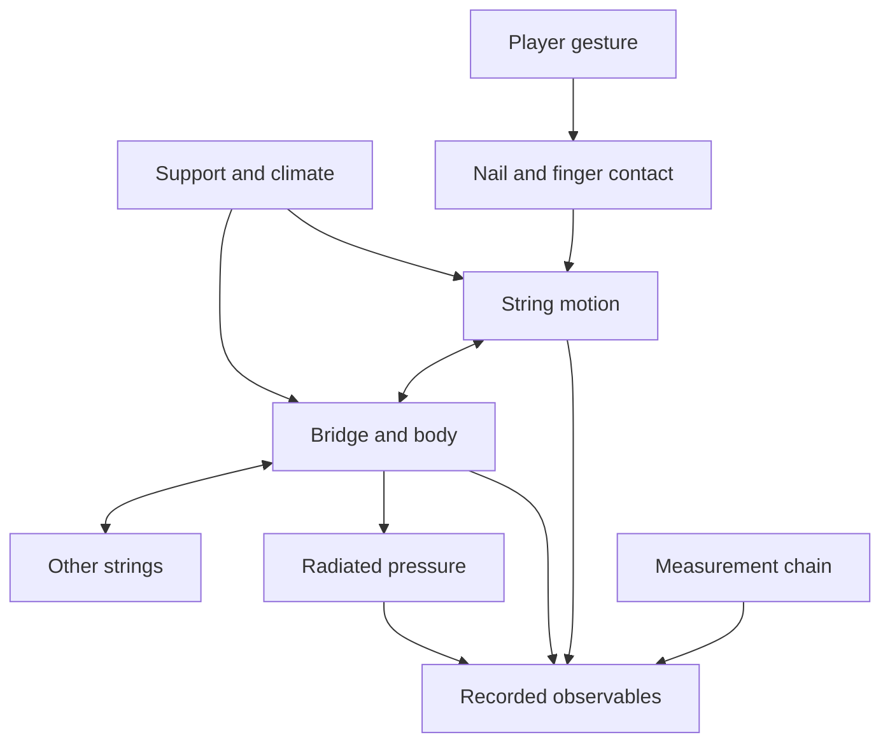

# Research questions, model boundaries, and decisive experiments

## Begin with a claim, not a measurement shopping list

A measurement earns its place when its result can change a model decision. A large
collection of files can be scientifically weak if no one can explain which
hypothesis each file tests. Conversely, a small well-calibrated experiment can
rule out an attractive but inadequate architecture. The first research artifact
is therefore a question register, not a recording session plan.

For each question, write the competing explanations, the observable that differs
between them, the nuisance variables that could mimic that difference, and the
decision to take for each plausible outcome. State what the experiment cannot
decide. If both candidate models predict indistinguishable observations within
uncertainty, the proposed measurement does not discriminate them. Improve the
excitation, add another observable, or choose the simpler model provisionally with
an explicit limitation.

The external sources in [the evidence ledger](evidence-ledger.md) motivate the
research domain. The experiments in this chapter are project proposals and
engineering deductions. They are not reproductions of those sources' protocols,
nor statements that these experiments have already been completed.

## Decompose the instrument by energy exchange

The useful boundary is not “string sound plus body equalization.” A vibrating
string applies force at a moving bridge; bridge motion changes the string's
termination, and mechanical energy can move among strings through the body. Nail
contact, fret contact, finger damping, supports, and radiation add other ports.
The experiment should expose those exchanges rather than identify isolated curves
that cannot be coupled consistently.

The diagram separates the physical object from its observation chain. Microphone
response, preamplifier gain, sensor loading, room reflections, and sample-clock
error are not properties to be fitted into the instrument merely because they
appear in the recorded signal. Their influence must be measured or bounded.

## Question family: string dispersion and loss

Start with an isolated, well-defined string configuration. Competing explanations
for partial-frequency deviation include bending stiffness, uncertain speaking
length, tension change under amplitude, termination compliance, and estimator
bias. A single open-note spectrum cannot identify all of them.

Measure partial frequency trajectories at several controlled excitation levels
and at more than one speaking length, while recording tuning state and boundary
configuration. A stiffness effect has a structured dependence on mode number;
termination and geometrical-length effects can produce different dependencies.
Amplitude-related tension changes should correlate with displacement or another
validated amplitude proxy. Use observations of both polarizations when feasible,
because split or exchanged polarization energy can masquerade as beating or
nonstationary damping in a single microphone channel.

For loss, ask whether one frequency-independent decay law predicts both the early
and late envelope across held-out notes. If not, determine whether the failure is
due to distributed string loss, body coupling, contact, or the noise floor. Avoid
fitting a separate arbitrary envelope to every note and calling the collection a
physical model. A useful progression is a constrained shared loss law, a
frequency-dependent extension justified by residual structure, then a coupling
model tested against changes in the other strings' tuning.

The decision gate is not a pleasing single note. It is a documented range of
lengths, amplitudes, and tunings over which one parameterization predicts partial
frequencies and decay behavior within the agreed uncertainty and perceptual
tolerance. Outside that range, label the behavior exploratory.

## Question family: bridge and body coupling

Ask whether a scalar bridge mobility suffices for the intended performance domain.
A set of strings applies forces at distinct locations and directions. A scalar
curve can miss lateral-to-normal coupling, torque, and cross-string transfer.
The proposed experiment measures a small multiport mobility matrix, beginning
with physically important directions and expanding only where residuals justify it.

Choose force and response ports whose directions are explicit in the specimen
frame. Measure reciprocal pairs where safe and feasible. Repeat at altered
excitation locations to distinguish an unobserved mode from an absent mode. Test
the same ports with unused strings damped and undamped, preserving preload as
closely as possible and documenting the damping intervention. A change in response
can reveal string-body interaction; it can also reveal the added damper's mass or
support effect, which needs a control.

Compare at least one laboratory support condition with a player-like supported
condition before fixing damping for synthesis. Similar peak frequencies do not
imply similar residues or decay. A reduced model that preserves resonance
locations but loses off-diagonal transfer may fail sympathetic resonance and
energy redistribution even when an isolated note sounds plausible.

The output is a decision on model order and port structure, together with a
passivity check. If a richer model does not improve held-out responses beyond
measurement uncertainty, retain the smaller one and document what was tested.
Model complexity is earned by predictive evidence, not by the number of available
finite-element degrees of freedom.

## Question family: contact and articulation

Ask which features of the initial contact must remain dynamic. A prescribed
initial triangular string displacement might approximate some plucks, but it
cannot automatically represent finite nail contact, repeated release, scraping,
or a finger that remains near the vibrating string. Compare that initialization
model with a finite-duration contact model using synchronized string motion,
gesture observations, and acoustic onset data.

The discriminating observables are release time, pre-release displacement,
polarization, high-frequency onset energy, and the sensitivity of these features
to approach direction and nail geometry. The comparison must account for sensor
bandwidth and occlusion. A video without enough temporal resolution cannot prove
an instantaneous release; it can only fail to resolve contact duration.

For fretting, separate contact location from added tension, damping, and possible
secondary contact. Compare controlled finger placements with the same fret and
string. Record displacement and force only through safe methods that do not
change the technique beyond the experiment's purpose. When an invasive sensor
changes the gesture, use it as a mechanism experiment, not as unqualified natural
performance ground truth.

A more complicated contact law is accepted only if it predicts held-out gestures
and remains stable, causal, and energy-consistent in the simulator. An onset
spectrum alone does not identify a unique friction law. Preserve alternative
mechanisms when the observations cannot distinguish them.

## Question family: tuning and sympathetic response

Ask whether the performance specification requires independent string tunings,
coupled courses, movable fret maps, continuous pitch gestures, and context-specific
interval targets. These are not interchangeable user-interface features. A pitch
offset changes an oscillator target; moving a fret changes the physical contact
location, speaking length, and potentially the available gesture.

Use a small player-reviewed tuning set for mechanism tests and a separate set for
generalization. For a selected melody-string note, compare other strings allowed
to ring, intentionally muted, and retuned under controlled conditions. Measure
late energy and cross-string motion where possible. If the model produces the same
response in all cases, it is missing a mechanism the experiment was designed to
test. If the recording differences are dominated by changed hand damping, revise
the protocol before attributing them to sympathetic coupling.

The deliverable is not a universal scale. It is a contextual representation that
stores the requested musical target, measured fret geometry, actual pitch
trajectory, and expert interpretation separately. The instrument must be able to
represent a deliberate tuning without pretending that one preset exhausts the
tradition.

## Question family: radiation versus room

Ask whether a single output filter is adequate for the intended listening model.
Body vibration and radiated pressure are different observables. Two structures
can have similar bridge mobility and different radiation efficiencies or
directivities. Conversely, a microphone-position change can alter a spectrum
without any change to the instrument.

Measure pressure transfer for controlled mechanical excitation at multiple
directions, while preserving calibrated phase where the acquisition supports it.
Separate an instrument-fixed coordinate system from the room-fixed microphone
coordinates. Check at more than one distance within the usable facility before
assuming a far-field scaling law. Treat the room's usable free-field range as a
measured limitation, not a name on a booking calendar.

If the plugin offers virtual microphone position, its interpolation must be
validated at held-out directions. If it offers only a single listening output,
state which reference condition it represents. An attractive stereo widening
effect may be a product option, but it is not measured radiation unless evidence
supports that claim.

## Prioritizing experiments

Score candidate experiments by expected decision impact, uncertainty reduction,
reversibility, specimen risk, rights complexity, and analysis burden. Do not use a
single score to conceal tradeoffs; retain the components. An experiment that could
damage the reference instrument is not justified merely because it scores highly
on information gain. A reversible witness-sample test may be preferable even when
its connection to the finished instrument is less direct.

Use pilot data to estimate variability and signal levels. Then freeze inclusion
criteria and the analysis plan before the main acquisition. Choose repetitions
according to the uncertainty needed for the decision, not an arbitrary universal
count. Independent remountings, strings, players, and specimens answer different
questions; many repeated strikes on one unchanged setup do not replace them.

## Required question record

Each approved experiment produces a record containing the physical proposition,
candidate models, input perturbation, measured outputs, nuisance controls,
instrument-risk review, rights scope, analysis method, uncertainty target, stopping
rule, and next action for each outcome. It also names the independent validation
data that will not be used to tune the model.

The register fails review when the proposed outcome is guaranteed to support the
preferred model, when no possible result would change a decision, or when missing
data are to be replaced by listening preference without disclosure. It passes
when the next team can perform the experiment, understand a negative result, and
know whether the model should be retained, extended, or rejected.

