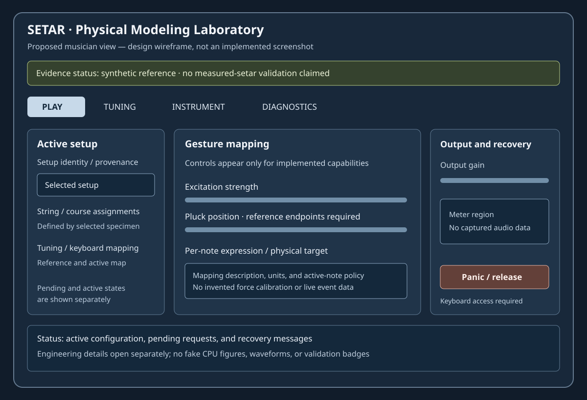

# Musician view: understandable control of a physical instrument

The musician interface should help a player make and recover musical decisions.
It is not an exhibition of every internal variable. This chapter specifies a
proposed interface and evaluation workflow. The wireframe is a design artifact,
not a screenshot of implemented software. Actual controls must appear only when
their behavior and evidence are available; a synthetic reference build should
say so plainly.

## Primary tasks

Design around playing, selecting a documented setup, understanding string/course
assignment, tuning, shaping a gesture, hearing the result, and recovering from
an unintended state. The first view should make the active setup, input mapping,
output level, and panic/recovery action discoverable. It should not require a
player to understand modal truncation or contact residuals to produce a note.

Separate musician and engineering views without hiding important status. A
musician needs to know that a preset failed to load or that the engine entered
protection. They do not need an ever-changing matrix condition number in the
main performance area. Engineering detail can explain the incident on demand,
while the musician message states what happened and how to recover.

Keep interface terms aligned with practitioner language and the selected mapping.
If a control is an artistic brightness macro, call it that rather than imply a
measured material property. If a gesture mapping is experimental, identify it.
Avoid imagery or terminology that substitutes an Indian sitar or generic guitar
for the Iranian setar. Have knowledgeable practitioners review labels and task
flows, not just the final visual style.

## Information hierarchy

Use an immediately visible active-state summary. It should show the selected
instrument/setup identity, tuning identity, playing mode, and whether a requested
change is still preparing. The requested preset and audible preset can differ
during preparation; make that distinction legible. Do not update the title to
the new preset before installation succeeds and thereby misrepresent what is
heard.

Group controls by action: play/gesture, tuning/string assignment, instrument
configuration, output, and diagnostics. Put rare structural changes in a distinct
area with an explanation of their preparation/reset consequence. Keep output
gain separate from physical excitation strength so the player can compare timbre
without accidentally changing the modeled gesture.

The proposed layout below reserves space for real status rather than fabricated
meters. Its labels are illustrative and must be reconciled with the implemented
parameter registry.

## Controls with physical meaning

For a pluck-position control, show the reference endpoints and whether the value
applies to future attacks or the ringing state. If the model uses a normalized
position along the active string segment, explain that distinction from distance
along the full instrument. A slider labeled “position” without a reference frame
is not an adequate physical interface.

For contact or damping, show the action being requested rather than a mysterious
coefficient. Advanced views may expose stiffness or loss parameters with units,
valid ranges, and uncertainty. Do not present inferred calibration constants as
directly measured values. If a parameter cannot be changed during sound without
a reset, make the behavior explicit before the change.

For tuning, display reference and per-string relationships in a way compatible
with the selected musical context. Do not force all tunings into twelve-tone or
fixed quarter-tone assumptions. Offer precise numeric entry where useful, but
keep terminology and preset provenance available. The instrument can support
user-defined tuning without claiming that every imported scale is idiomatic.

## Interaction consistency

Mouse drag, keyboard adjustment, text entry, reset, host automation, and external
controller input should converge on one parameter authority. Do not let each
route maintain its own value. Show the actual current/target relationship where
a transition is meaningful. If automation is controlling a value, UI edits must
follow the host's declared gesture/override behavior instead of silently fighting
it.

Use consistent fine/coarse adjustment and reset conventions. Provide a text
entry path for precision and a cancel path that restores the prior value.
Invalid input should explain the accepted range/unit without partially applying
a malformed number. Locale-specific decimal behavior must be tested; a comma
must not be interpreted as a thousands separator or truncated value by accident.

Undo should match a musician's action. A drag is usually one conceptual edit;
loading a setup is a transaction. State whether undo restores only parameters
or also physical sounding state. Avoid promising exact acoustic continuation
when the engine only restores configuration. Host undo and plugin-local undo
need a documented relationship so they do not apply the same change twice.

## Input mapping transparency

Provide a concise mapping view showing which controller dimension affects which
target. In MPE, identify per-note versus global controls. A player should be able
to understand why one note bends while a companion string rings unchanged.
For a physically constrained playing mode, show rejected or reassigned notes
without overwhelming performance with notifications.

Controller calibration should be discoverable where it affects range or neutral
position. Show idle jitter only in diagnostics, not as a constantly flashing
warning. Explain filtering or sensitivity settings in terms of response and
tradeoffs. Do not label a controller pressure unit “newtons” unless a valid
calibration establishes that relationship.

Provide a visible panic/recovery action with a keyboard-accessible equivalent.
Its behavior should match tested event-termination semantics. A user must not
need to close the host or delete the plugin to recover from a stuck mapping.
After an overflow incident, show that recovery occurred and preserve technical
details outside the main performance flow.

## Pending, failed, and unavailable states

Preparation can take nontrivial time without belonging to the callback. Display
the active sound and pending request separately. Permit cancellation when the
underlying operation supports it. A canceled older job must not replace a newer
selection after finishing. Disable only controls whose meaning is genuinely
undefined, and explain why unavailable features cannot be used.

A missing measurement asset should not be represented by an attractive fake
curve. Use an empty state identifying the missing input and the consequence.
A synthetic demonstration should have a stable, unobtrusive label indicating
that it is a numerical reference, not a measured instrument. Evidence honesty
can coexist with a polished interface.

Error language names the failed action and safe next step: “This tuning file
could not be loaded; the previous tuning remains active” is more useful than
“Error 12.” Preserve a diagnostic code for support, but do not expose stack
traces or private file paths in the musician view by default.

## Evaluation tasks

Evaluate the interface with tasks rather than only opinions. Ask a participant
to identify the active tuning, make a small reversible change, create a stronger
attack without changing output gain, assign an expressive control, restore a
setup, recover from a deliberately invalid import, and find the model's evidence
status. Record success, wrong turns, recovery, and explanations in the player's
own words.

Separate first-use discoverability from learned performance control. A participant
may initially need help with a sophisticated mapping but later value its range.
Conversely, a visually obvious knob can remain semantically misleading after
practice. Preserve task context, controller, build, and audio configuration so
feedback is interpretable.

Do not infer cultural correctness from generic usability success. Practitioner
review should address tuning labels, gesture semantics, and instrument
representation. Do not imply endorsement without permission. Treat conflicting
practitioner preferences as evidence of variation to support, not an error to
average into a fictitious universal style.

## Acceptance and next action

Acceptance requires a mapped parameter registry, consistent input routes,
transactional state behavior, accessible navigation, tested empty/error states,
and task-based evaluation. Screenshots support layout review but do not prove
control semantics. The next action is a minimal functional view over verified
capabilities, captured authentically and tested with numeric assertions before
expanding the control surface.
