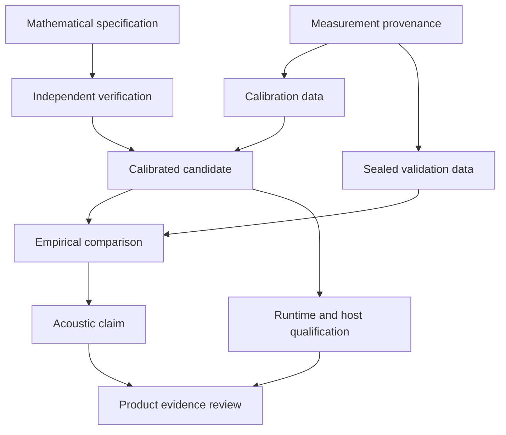

# Evidence contract: what a result permits us to claim

This chapter defines vocabulary for the validation, real-time, plugin, and
interface volumes. It is a specification for work, not a report that the work
has passed. A string oscillator, a pleasant demonstration, a clean compiler run,
and a persuasive screenshot are useful intermediate results; none establishes
that the model behaves like a measured Iranian setar. The aspiration to the
quality of mature commercial physical instruments is a research direction,
not an equivalence claim or an acceptance metric.

## Four different questions

Verification asks whether an implementation solves its stated mathematical and
software problem correctly. A string solver can be verified against an analytic
solution while representing the wrong boundary condition for the instrument.
Validation asks whether a model adequately represents observed instrument
behavior for a declared use. A fitted note can agree with a recording while
failing at other frets. Product qualification asks whether the binary behaves
safely and predictably in supported hosts. Usability evaluation asks whether
musicians can understand and control the intended behavior. Their evidence
intersects, but no question substitutes for the others.

A useful claim names an object, conditions, comparison, and limitation. “The
isolated lossless-string integrator conserves its discrete energy within the
declared floating-point envelope for fixture E17 at the tested step sizes” is
verification. “The fitted model reproduces selected partial decay trajectories
of this instrument, tuning, excitation range, and microphone view within the
registered interval” is validation. “The plugin restored the same parameter
state in the listed hosts” is product evidence. Do not collapse these into
“the setar is accurate.”

## Execution states and provenance labels

These execution states complement the provenance labels in
[START_HERE](../START_HERE.md). `Synthetic`, `published`, and `measured` describe
information's origin, not whether a test passed.

| State | Meaning | Does not establish |
| --- | --- | --- |
| Proposed | Candidate design, threshold, or experiment | Implementation or justification |
| Specified | Inputs, procedure, oracle, and artifacts defined | Execution |
| Implemented | Identifiable code or apparatus exists | Correctness or fidelity |
| Executed | Identifiable run produced preserved outputs | Passing result |
| Verified | Implementation test passed within scope | Instrument agreement |
| Validated | Empirical claim passed a reviewed experiment | Universal fidelity |
| Blocked | Required evidence cannot presently be obtained | Success with an exception |
| Rejected | Evidence contradicts the claim | Failure of unrelated claims |
| Superseded | New record replaces the interpretation | Permission to erase the record |

Preserve a failed run when a later run passes. If an oracle was wrong, mark the
old result invalid for that reason; do not relabel the old binary as passing.
Attach the review to the replacement. A status combines immutable evidence with
a revisable interpretation. This permits honest correction without rewriting
what was actually run.

## Claim ledger

Assign a stable identifier such as `VAL-DECAY-OPEN-001` before implementation.
Record the observable, model revision, applicability domain, independent and
nuisance variables, uncertainty sources, and evidence required. Answer:

1. Which specimen, string arrangement, tuning, contact condition, and gesture?
2. Is the target an individual specimen, a population, or a useful musical family?
3. Is the output displacement, bridge velocity, pressure, microphone voltage,
   or a perceptual judgment?
4. Which data were available during fitting and which remained sealed?
5. Which preprocessing is permitted, and which would invalidate the claim?
6. Which numerical and experimental uncertainties remain?
7. Which artifacts let an independent engineer repeat the decision?

When a body filter is retuned to a held-out recording, that recording becomes
development data. Change its role in the manifest and obtain a fresh holdout
before renewing a generalization claim. Calling an optimizer “manual listening”
does not preserve the holdout if engineers repeatedly change the model in
response to the same supposedly unseen examples.

## Gates are evidence dependencies

A listening comparison cannot decide between discretizations when one is
unstable under a plausible gesture. Correct the invalid candidate first.
Conversely, convergence cannot replace listening: an accurately solved but
incomplete contact model may sound wrong.

This is a dependency diagram, not a calendar. A gate can fail without stopping
unrelated work. An interface engineer can evaluate keyboard navigation while
acoustic validation is blocked, using a clearly labeled synthetic fixture.
The interface must not then be presented as a validated instrument.

## Minimum evidence packet

Each packet contains a manifest, input identifiers and hashes, code revision,
build settings, dependency versions, command or case identifier, relevant machine
description, raw and derived outputs, and interpretation. Identify every
transformation between raw input and the reported number. A graph without its
numeric source and processing configuration is an illustration, not a
reproducible result.

Physical packets add calibration, geometry, excitation definition, environmental
observations, permissions, and failed-take accounting. Host packets add host
version, architecture, format, plugin hash, sample rate, block behavior,
transport operations, parameter events, and logs. Screenshots add executable
identity, viewport, scale, fixture state, font policy, and capture method.
Listening packets add preregistration, randomization, exclusions, anonymized
responses, and analysis revision. Do not publish unnecessary participant details.

An absent result is not a zero. “No allocation observed in these callbacks”
differs from “allocation instrumentation did not run.” An upload failure is not
proof of test failure, but prevents an auditable gate until evidence is recovered.
Likewise, a report generator crash should not convert partially produced results
into a completed result merely because a PNG was left in the output folder.

## Review uncomfortable outcomes

Preserve the smallest input exposing a defect. Ask whether it originates in the
physical model, discretization, parameter interpretation, measurement chain,
statistics, wrapper, or presentation. A category is a hypothesis; seek an
intervention that distinguishes it from alternatives.

Do not improve a score by dropping hard notes, widening thresholds after seeing
failures, aligning away meaningful attacks, or normalizing away missing dynamics.
A legitimate exclusion, such as clipping in a reference, needs a visible and
consistently applied rule. If discovered afterward, show the original result and
the justified reanalysis. A fitted parameter at its allowed boundary is a warning:
calibration may be compensating for absent physics.

Reviewers must be able to disagree without losing access to evidence. Retain
negative listening results, failed candidates, and measurement anomalies. The
product summary can be concise, but points to the technical packet. A failure
that narrows the model's validity domain is useful progress when reported clearly.

## Handoff and acceptance

Each engineer states the prerequisite gate, precise change, independent oracle,
affected platforms, artifacts, limitations, and next decision enabled. “Tests
pass” needs named tests and runs. “CI configured” cannot become “tested on Linux,
Windows, and macOS” without observed runs. A generic C++ executable does not
exercise a VST3 wrapper or Audio Unit bundle.

An acoustic claim should receive review independent of the final fit. A real-time
claim needs a callback call graph and adversarial workload. A visual claim needs
semantic interaction tests because an unchanged screenshot can hide broken
behavior. These perspectives complement one another; no reviewer must pretend
to be an expert in every discipline.

This contract is usable when reports can express blocked, unrun, and rejected
work without disguising it as success. The next action is a claim ledger for the
first isolated subsystem and a linked verification packet. Until that exists,
this chapter defines a method, not a completed or validated instrument.
